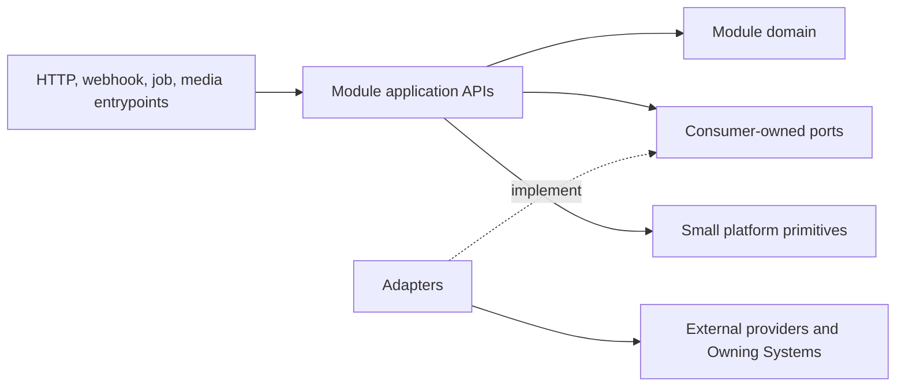
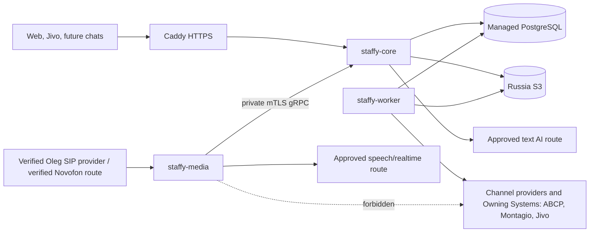
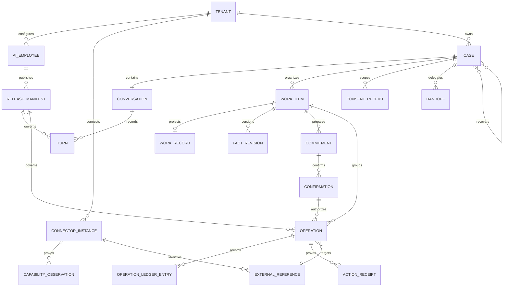

# Architecture Spine — Staffy

## Design Paradigm

Staffy is one multi-tenant product implemented as a Go modular monolith under Ports & Adapters. Six business modules own state and expose typed application APIs. Provider, storage, AI, and transport adapters implement consumer-owned ports. Realtime/media is a separately deployable edge with no business authority. A module becomes a service only when measured load, failure-isolation, security-isolation, or independent-release needs justify it.



The six modules are `identity`, `employee`, `case`, `action`, `connector` and `evidence`. Domain Packs are versioned data over their contracts, not modules or tenant forks. Protected continuation and the optional minimal operator Inbox are Case surfaces. Media is an edge, not a seventh business module.

## Current Status and Use

This adopted spine defines the build boundary; it does not claim that open integrations or live routes already work. Implementation may begin with synthetic data. A controlled real-customer route is admitted only by all applicable scoped instances in `GATE-REGISTRY.md`. The first build slices are the read-only/safe UJ-A1 path and the farthest-safe UJ-M1/UJ-M2 qualification path in the capability map; open gates keep narrower branches assisted, human-only, or unavailable.

## Invariants & Rules

### AD-1 — [ADOPTED] One core, four customization layers

- **Binds:** FR-1–FR-8, FR-49, FR-78–FR-85, all tenants.
- **Prevents:** Per-tenant code forks and a new runtime for every industry.
- **Rule:** Customization is common core -> declarative versioned Domain Pack -> tenant/employee configuration -> reusable code-based Connector. A supported combination is configurable without a programmer. Support for a missing class of external system requires an assisted, reusable Connector extension—never tenant-specific core code.

### AD-2 — [ADOPTED] Module ownership and dependency direction

- **Binds:** all Go code, schema and tests.
- **Prevents:** A coupled monolith whose modules share tables, DTOs or hidden network calls.
- **Rule:** Each module owns its model, tables and transactions. Its internal shape is `api/`, `app/`, `domain/`, `port/`, `store/`; only that module may import its `store`. Cross-module synchronous calls use the provider module's typed `api`, while external dependencies implement consumer-owned `port` interfaces. `cmd/*` composition roots alone wire adapters. A transaction belongs to its initiating aggregate or module. For a durable cross-module or external side effect, the initiating module commits domain state and an outbox record; processing then continues idempotently. Dependency cycles, cross-module SQL, provider DTO leakage, `utils`/`helpers`/`common`, global mutable dependencies and tenant-name branches in core are prohibited and checked in CI. Internal calls remain direct Go calls, not RPC.

Allowed synchronous imports form this acyclic DAG: `employee -> identity/api`; `connector -> identity/api`; `case -> identity/api, employee/api, connector/api` (reads only); `action -> identity/api, employee/api, case/api, connector/api`; `evidence -> identity/api` only. Evidence consumes other modules through versioned outbox events. Entrypoints call module APIs, and composition roots may wire interfaces but may not contain domain policy. CI rejects undeclared imports, cyclic application calls and SQL access outside the owning module migration/store path.

### AD-3 — [ADOPTED] One declared Owning System

- **Binds:** FR-10–FR-12, FR-19–FR-21, FR-25, FR-28–FR-31, FR-56–FR-60, FR-63–FR-77.
- **Prevents:** Staffy silently becoming a competing CRM/order/payment truth.
- **Rule:** Every material field or entity has one declared Owning System, external ID, version, observation time, allowed Staffy projection, conflict rule, reconciliation query, and terminal evidence. Staffy owns Case/conversation provenance, Work Items, confirmations, controls and operation evidence; tenant systems own their declared business records. A minimal Work Record is a Case-owned projection/surface, not a seventh module, and is allowed only when Staffy is explicitly declared owner. Unknown/conflict blocks affected claims and mutations.

### AD-4 — [ADOPTED] One Case and canonical lifecycle

- **Binds:** FR-9–FR-17, FR-25, FR-33–FR-41, all UJ.
- **Prevents:** Duplicate conversations, contradictory promises and context loss across channels.
- **Rule:** The lifecycle is: Channel Event -> one logical Conversation within a Case -> one or more Work Items -> versioned facts, mode and Response Owner -> Commitment -> exact-version Confirmation -> Action -> Receipt or reconciliation -> continuation, acknowledged handoff or linked Recovery Case. Facts, commitments, waits and actions bind a Work Item so parallel topics can pause/resume without cross-contamination. Identity is never merged by guess. There is exactly one Response Owner and writable surface per conversation; ownership uses a monotonic `response_owner_epoch`, and requested handoff freezes incompatible actions until the target acknowledges. Rejection, disappearance or acknowledgement timeout keeps or restores the previous safe owner, cancels the request and selects the declared backup or an honest wait/callback. Recovery links are acyclic, and each failed Operation has at most one active recovery parent.

### AD-5 — [ADOPTED] Evidence-backed Connector contract

- **Binds:** FR-7–FR-8, FR-13, FR-17, FR-19, FR-27–FR-31, FR-37, FR-49, FR-61, FR-78–FR-83.
- **Prevents:** Provider-specific semantics redefining platform truth.
- **Rule:** First-party V1 adapters compile into the monolith behind a process-neutral contract: Channel Event; typed Read Request and Observation; account-scoped Capability Evidence; Action Request and Action Receipt; and, where supported, typed Cancel Request and Receipt or Compensation Request and Receipt. Every contract declares timeout, ordering, rate/size limits and unsupported semantics. Ingress verifies and deduplicates events. Outbound processing preserves idempotency and external IDs, then reconciles outcomes. A cancel or compensation timeout after a possible effect becomes `unknown/reconciling` and cannot be retried blindly. API acceptance is not delivery or business completion. Unknown never becomes success or blind retry. Connector code cannot invoke the model or decide policy.

### AD-6 — [ADOPTED] Action Gateway is the only mutation path

- **Binds:** FR-22, FR-27–FR-33, FR-39, FR-42, FR-45, all material actions.
- **Prevents:** Model, handler, stale job or Connector bypassing authority and confirmation.
- **Rule:** Exact preview -> fresh Owning-System read -> policy/capability/authority checks -> exact-version Confirmation -> atomic Operation+outbox -> execute-time revalidation -> Connector dispatch -> evidence-specific receipt/reconciliation. Confirmation binds an explicit finite action set and material snapshot, `valid_until`, revocation and consumption limits; material change, expiry, revocation or exhausted consumption requires a new Confirmation. Consuming that allowance, reserving the tenant+Owning-System business-intent key and creating the Operation+outbox record happen in one database transaction; a conflict consumes nothing and dispatches nothing. Only `action` constructs an Authorized Action, and mutation adapters are importable only by its dispatch composition root. Core processes receive read-only provider scopes and egress permissions. Workers receive narrow destination allowlists. Each capability is classified `provider_idempotent`, `query_reconcilable`, `compensatable` or `unsafe`; an unsafe capability remains assisted/human-only unless a separately accepted one-shot plus human-reconciliation procedure exists. Immediately before send, the dispatcher revalidates tenant, Case, turn, `response_owner_epoch`, control generation, Release Manifest, a keyed/versioned commitment token for content and materiality, deadline and idempotency key; any stale fence fails closed. The same idempotency key with a different material payload is a conflict. A tenant suspension/deletion advances the tenant control generation, revokes principals and invalidates queued dispatch. Equivalent requests across Cases must acquire that business-intent reservation or reconcile before either mutation. Five laws bind implementation: persist before emit; confirm before mutate; revalidate before dispatch; acknowledge before handoff; reconcile before retry.

For Oleg's controlled Autoparts class, Staffy may create only an exact-version ABCP prepared/client order after customer Confirmation. `supplier_form/send` is absent from the AI/Staffy Action Catalog. A named manager rereads current ABCP version and applicability evidence, acknowledges, approves or blocks with a separate human receipt, then performs a final version-matched reread and manually sends to the supplier. Any material VIN, vehicle, item, quantity, price or fitment change invalidates the affected customer Confirmation and manager approval. Removing this fence requires a separately scoped autonomy decision, Release Manifest and gate evidence; OQ-3 or OQ-5 PASS alone cannot remove it.

### AD-7 — [ADOPTED] Typed bounded AI planner

- **Binds:** FR-14–FR-26, FR-36, FR-43, FR-48, FR-50–FR-55, FR-64–FR-76, FR-80–FR-82.
- **Prevents:** Autonomous tool chains, hallucinated authority and scripted-only conversation.
- **Rule:** One Conversation Planner receives a minimized typed Turn Context and returns a versioned Turn Proposal with intent/mode, safety, fact proposals/provenance, contradictions, typed reads, questions, proposed Commitment/action/handoff, reply, evidence refs and Case-memory patch. Strict validation permits one repair attempt. A second validation failure is persisted and yields only an approved safe fallback, handoff or callback—never model output. The model may request deterministic/read tools and propose an action type; executable writes never enter its tool set. Tool rounds, execution time and cost are bounded.

### AD-8 — [ADOPTED] Evidence-scoped knowledge and memory

- **Binds:** FR-10, FR-18–FR-25, FR-43, FR-50–FR-55, FR-64–FR-69, FR-79–FR-82.
- **Prevents:** RAG replacing operational truth, cross-tenant leakage and silent memory.
- **Rule:** Knowledge ingestion is quarantine/validate -> extract -> version/provenance -> tenant/purpose label -> index -> eval -> publish. Retrieval returns authority/source/version/time and never substitutes for current price, stock, availability or status. V1 memory is Case-scoped, structured, versioned and contestable; summaries do not replace sources and hidden chain-of-thought is not stored. Full text is baseline; vector retrieval is optional behind a port after eval evidence.

### AD-9 — [ADOPTED] Same contract across text and voice

- **Binds:** FR-9–FR-17, FR-25–FR-26, FR-33–FR-37, FR-81–FR-82, voice NFRs.
- **Prevents:** A separate voice bot with weaker safety or incompatible state.
- **Rule:** Text and voice use the same Case, Planner, Commitment, Confirmation, Action and handoff contracts. Media owns SIP/audio, VAD/barge-in, STT/TTS or speech-to-speech mechanics only. Material speech is gated and persisted before playback. Core issues a short-lived, one-use, signed playback permit containing the full writer fence; Media validates it immediately before each material frame and cancels on a newer owner/control generation. A late acknowledgement is accepted only for the current session, turn, stream generation and content token. Delivery evidence distinguishes `generated`, `sent_to_provider`, `playback_acknowledged_or_estimated` and `customer_confirmed`; playback never proves that content was heard, understood or confirmed. Barge-in or disconnect requires repair/readback before relying on material content. Media has no DB or Owning-System access. Speech-to-speech may handle material turns only if it yields the typed proposal and evidence boundary.

### AD-10 — [ADOPTED] Hybrid state plus immutable material evidence

- **Binds:** all persistence, audit and correction behavior.
- **Prevents:** Full event-sourcing complexity and mutable-state loss of truth.
- **Rule:** Current operational state uses relational storage and optimistic versioning. Logical/audit transitions for messages, fact revisions, purpose consents, Commitments, Confirmations, ownership, Operation Ledger/receipts, knowledge and release/eval evidence are append-only; correction creates `supersedes_id`. This does not mean indefinite PII retention: encrypted/retractable payloads are separated from a minimal non-PII ledger, and purpose-specific retention and deletion can tombstone or cryptographically erase payloads and supported provider copies subject to legal hold. Content binding uses a keyed, versioned HMAC or high-entropy canonical commitment token; raw unsalted hashes of phone numbers, VINs, addresses or short customer text are forbidden, and token-key rotation/destruction follows retention policy. Confirmation binds the exact Commitment version and token. Every turn and Operation binds its Release Manifest.

### AD-11 — [ADOPTED] Tenant, identity, privacy and secret boundaries

- **Binds:** FR-1–FR-2, FR-11, FR-15–FR-16, FR-26–FR-32, FR-34–FR-41, privacy/security/accessibility NFRs.
- **Prevents:** Cross-tenant access, secret exposure, consent conflation and prompt/tool injection.
- **Rule:** Verified identity establishes TenantContext; every tenant table carries `tenant_id`, tenant-aware keys, `ENABLE ROW LEVEL SECURITY` and `FORCE ROW LEVEL SECURITY`. Runtime roles are non-owner, non-superuser and `NOBYPASSRLS`; a request or job obtains tenant scope from verified identity or trusted scheduler metadata—never from the request or job payload—and applies `SET LOCAL` only inside a transaction. Missing scope fails before SQL. Privileged maintenance uses a separate audited principal. Negative integration tests cover cross-tenant reads/writes/FKs, prepared statements, pooled-connection reuse, jobs, support and restore paths. Human roles are Owner, Configurator, Operator, Expert/QA and Integration Admin; AI/Connector/workers are separate principals. Owner/Integration Admin use MFA for sensitive administration. Before Case creation, a channel-session record captures purpose-specific legal basis/consent, capture-buffer policy and control generation; after identity resolution it is linked or promoted into the Case. Consent and withdrawal are purpose-specific across recording, STT/model processing, media, transfer and marketing. Withdrawal after processing/mutation begins triggers supported cancellation, reconciliation, eligible-copy deletion and disclosure of irreversible effects. SecretStore values never enter prompts/logs/receipts. Untrusted content cannot change Tenant, tools, authority or destinations. Raw-content support access is time/scope-limited and audited.

### AD-12 — [ADOPTED] Scoped autonomy and immutable release admission

- **Binds:** FR-3–FR-6, FR-32, FR-42–FR-49, FR-78–FR-85, SM-1–SM-4.
- **Prevents:** Global autonomy promotion, silent self-modification and broad shutdowns.
- **Rule:** Autonomy binds tenant+employee+Release Manifest+Domain Pack/Autonomy Class+action+channel/modality+Operating Profile. Modes are shadow, copilot, assisted, auto and exception; controls are accept, intake_only/no_promises, human_only and paused, with the most restrictive result. Release is draft -> validation -> offline eval/sandbox -> human approval -> canary/controlled -> active. Model/prompt/policy/tool/retrieval/route changes produce a new manifest. Every affected release must pass AG-2 accessibility admission: automated and manual WCAG 2.2 AA checks for keyboard, screen reader, reflow, text spacing, forced colors, touch, reduced motion and equivalent voice/text/DTMF/human paths. Correction of a Case is separate from improvement of an employee.

### AD-13 — [ADOPTED] PostgreSQL transaction backbone

- **Binds:** all transactional state, jobs and integration delivery.
- **Prevents:** Distributed transactions, premature brokers and duplicate side effects.
- **Rule:** One PostgreSQL 18 database/shared schema uses tenant RLS, explicit SQL, transactional outbox and leased at-least-once jobs with deadlines, bounded retries, jitter, fencing, dead-letter and human fallback. Operation Ledger is append-only. No 2PC crosses an Owning System. Redis, Kafka and NATS are absent in V1. River is isolated behind `JobQueue` and is never domain truth.

### AD-14 — [ADOPTED] Fail-safe reliability and deployment

- **Binds:** deployment, operations and availability NFRs.
- **Prevents:** One provider failure becoming global failure or false success.
- **Rule:** Live pilots have an Application Node running `staffy-core` and `staffy-worker` from one build as separate supervised processes/containers with independent CPU, memory and file-descriptor limits, DB pools and health checks, plus a separate Realtime/Media Node. Ingress, control, handoff and reconciliation capacity is reserved; eval/sync work sheds first. PostgreSQL and Russia-hosted S3 are managed. Breakers and backpressure are Tenant+Connector+Capability scoped. Material work is durable; timeout after possible write is unknown/reconciling. Builds are immutable; migrations use expand/migrate/contract; current+previous job/event contracts coexist. Before controlled traffic, AG-1 proves a Pilot Load Envelope covering concurrency, bursts, codec/bitrate, fanout/timeouts, queues/handoff, provider limits, storage/retention, cost, safety factor and over-limit behavior. OQ-13B requires an actual restore/rebind/reconcile/media-replacement drill; the stated RTO/RPO values remain objectives until that proof. V1 has no Kubernetes, service mesh or active-active multiregion.

### AD-15 — [ADOPTED] Measured truth and cost

- **Binds:** FR-43–FR-49, FR-63, FR-75, FR-84–FR-85, SM-1–SM-20 and counter-metrics.
- **Prevents:** Attractive averages masking unsafe routes or uneconomic automation.
- **Rule:** One safe correlation envelope links tenant, Case/turn, release/class/profile, route, Connector, Operation, outcome, latency and full cost. OpenTelemetry operational data, PostgreSQL business/eval projections and protected raw artifacts stay separate. Evidence projections consume versioned domain events committed through each publisher's transactional outbox; consumers are idempotent, checkpointed and replayable, accept current+previous schemas during rollout and never query another module's private tables. A Measurement Dictionary defines denominator/source/terminal timing/slices/threshold. Critical safety/action/handoff/unknown events are unsampled; a critical route failure blocks that route regardless of averages. Business outcomes come only from Owning Systems.

### AD-16 — [ADOPTED] Gates are executable and expiring

- **Binds:** OQ-1–OQ-19, every release and commercial promise.
- **Prevents:** Assumptions and demos being treated as production capability.
- **Rule:** `GATE-REGISTRY.md` is normative. Gate definitions and scoped instances are distinct; allowed states are `open`, `in_test`, `pass`, `fail`, `expired` and `not_applicable`. Every applicable gate is conjunctive: execution order never lets a test bypass privacy, safety or legal admission. Runtime-affecting PASS records scope, evidence links, tested time, expiry/retest trigger, approver and exact permissions in Capability Evidence, Operating Profile or Release Manifest. A missing, failed or expired gate triggers the declared fail-closed fallback and invalidates affected queued work through scoped control generation. OQ-13A records the best-effort/no-SLA policy; OQ-13B remains open until recovery proof. AD-3 adopts the OQ-19 platform rule, but only a scoped OQ-19 instance for a Connector and material field set may grant mutation permission.

## Consistency Conventions

| Concern | Convention |
| --- | --- |
| Go/source naming | Singular lowercase packages; exported domain names in Go style; provider adapters named by provider; no generic utility packages. |
| Database/JSON | `snake_case`; typed UUIDv7 IDs; every tenant row has `tenant_id`; money is integer minor units + ISO currency; UTC `timestamptz` and RFC3339. |
| External identity | `(connector_instance_id, provider_event_id)` for ingress; External Reference includes Owning System/type/ID/version/observed time. Same ID/different payload is conflict. |
| HTTP | `/v1`, OpenAPI 3.1 validation, `snake_case` JSON; stable problem shape with code, localized-safe message, correlation ID, retryability and field errors. |
| Concurrency | Expected aggregate/config/external version on material commands; stale writes return explicit conflict/recovery, never last-write-wins. |
| Events/jobs | Versioned canonical envelope; transactional outbox; at-least-once consumers are idempotent; current and previous schema versions coexist during rollout. A surviving older payload is quarantined for explicit migration or human recovery, never dropped. |
| Errors | Domain error codes are stable English identifiers; UI text is localized separately; unknown/partial/stale are first-class states. |
| Generated code | OpenAPI, Protobuf and sqlc output is isolated and never hand-edited. |
| Migrations | Forward-only expand -> migrate/backfill -> contract; replacement and destructive removal never ship as one incompatible step. |
| Logging | Structured `slog` + correlation; no raw PII, credentials or conversation text in ordinary logs/metric labels/span names. |
| Configuration | Canonical JSON + JSON Schema; bounded CEL predicates; published artifacts are immutable and content-hashed. |
| Testing | Every Connector covers happy, duplicate/conflict, denial, capability loss, timeout/unknown and reconcile paths; journeys cover text, voice, interruption and recovery. |

## Stack

| Name | Version |
| --- | --- |
| Go | 1.27.1 |
| PostgreSQL | 18.6 |
| pgx | 5.11.0 |
| sqlc | 1.31.1 |
| goose | 3.27.3 |
| River behind `JobQueue` | 0.47.0 |
| OpenAPI | 3.1 |
| oapi-codegen | 2.8.0 |
| gRPC-Go | 1.83.2 |
| google.golang.org/protobuf + protoc-gen-go | 1.36.11 |
| protoc-gen-go-grpc | 1.6.2 |
| protoc | 35.0 |
| JSON Schema | 2020-12 |
| CEL-Go | 0.30.0 |
| htmx (self-hosted) | 2.0.10 |
| OpenTelemetry Go | 1.46.0 |
| Caddy | 2.11.3 |
| Asterisk edge, optional | 22.11.0 LTS |
| Testcontainers-Go | 0.43.0 |
| Playwright | 1.63.0 |
| Node.js | 24.21.0 LTS |

Exact versions are locked in builds and updated through tests/canary; code manifests own versions after repository bootstrap.

## Structural Seed

```text
staffy/
  cmd/
    staffy-core/       # HTTP, admin, webhooks, text
    staffy-worker/     # jobs, dispatch, reconcile
    staffy-media/      # live voice edge
  internal/
    identity/ employee/ case/ action/ connector/ evidence/
      api/ app/ domain/ port/ store/
    platform/          # tenancy, clock, IDs, transaction, telemetry
    adapters/          # postgres, providers, object/secret stores, AI
    transport/         # HTTP and private media contracts
    jobs/
  contracts/
    openapi/ protobuf/ jsonschema/ examples/
  domainpacks/
    autoparts/ services/
  web/
    templates/ assets/
  migrations/
    identity/ employee/ case/ action/ connector/ evidence/
  tests/
    contract/ integration/ replay/ journeys/ voice/
  deploy/
```



Only the media edge accepts allowlisted SIP/RTP. Public HTTPS enters through Caddy. PostgreSQL, S3 and secrets are private. Text leaves through Action Gateway/outbox. Local may co-run binaries; preproduction never receives production data. Core replicas are stateless, workers use fenced leases and active calls are pinned to a media node.



## Capability → Architecture Map

| Capability / Area | Lives in | Governed by |
| --- | --- | --- |
| Tenant, roles, access, entitlement | `identity` | AD-2, AD-11 |
| Employee setup, Domain Pack, profile, release | `employee` | AD-1, AD-12 |
| Omnichannel Case, facts, owner, consent, commitments | `case` | AD-3, AD-4, AD-10 |
| Work Items and minimal Work Record surface | `case` | AD-3, AD-4 |
| Business mutation, receipt and recovery | `action` + `connector` | AD-5, AD-6, AD-13 |
| Integration readiness and provider semantics | `connector` + Gate Registry | AD-5, AD-16 |
| Dialogue, selling, policy and tools | Planner + Domain Pack | AD-7, AD-8 |
| Knowledge, eval, usage, outcomes and cost | `evidence` | AD-8, AD-15 |
| Voice and interruption | `staffy-media` + core contracts | AD-9, AD-14 |
| Oleg autoparts pilot | Autoparts Pack + verified Oleg SIP provider (Mango candidate), Jivo and ABCP adapters | AD-1–AD-16; OQ-1–OQ-6/OQ-19 |
| Montagio services pilot | Services Pack + Novofon candidate, web and Montagio adapters; UJ-M3 via assisted/manual protected continuation | AD-1–AD-16; OQ-7–OQ-12/OQ-19 |
| Guided SSR product experience | `web` surfaces over module APIs | UX spines, AD-1, AD-4, AD-11–AD-12 |
| Operations and release admission | `evidence`, jobs, controls | AD-12–AD-16 |
| UJ-A1 slice 1 — text/read | Verified Jivo ingress -> Case/Work Item -> verified fitment read -> safe answer/handoff | Exit: OQ-2, OQ-5, OQ-11 Jivo+Staffy data, AG-2, AG-4 |
| UJ-A1 slice 1 — voice/read | Verified Oleg SIP route -> Case/Work Item -> verified fitment read -> safe answer/handoff | Exit: OQ-1, OQ-5, OQ-11 SIP+speech+Staffy data, OQ-12, OQ-13B, AG-1, AG-2, AG-4 |
| UJ-A1 slice 2 + UJ-A7 manager review | Exact-version customer Confirmation -> ABCP prepared order -> manager verification; no supplier send | Exit: OQ-3, OQ-4, OQ-5, OQ-11 affected flows, OQ-19 Oleg, AG-1/AG-2 for the chosen channel, AG-4. Full controlled UJ-A1 requires slice 1 and slice 2. |
| Walking skeleton UJ-M1/UJ-M2 web | Web -> Case/Work Item -> qualification -> protected continuation/handoff; no final Order/payment | Exit: OQ-7A, OQ-8, OQ-9 before price display, OQ-11 Staffy+Montagio data, AG-2, AG-4 |
| Walking skeleton UJ-M1/UJ-M2 voice | Verified Novofon route -> same qualification path; no final Order/payment | Exit: OQ-7A, OQ-8, OQ-9 before price display, OQ-11 carrier+speech+Staffy+Montagio data, OQ-12, OQ-13B, AG-1, AG-2, AG-4 |
| Third-tenant reuse proof | Supported Domain Pack + Connectors + real inputs/admin, controlled within one workday with participant log and code-diff proof | AG-3; SM-4 |

## Deferred

- OQ-1–OQ-12, OQ-13B and OQ-14–OQ-19 follow `GATE-REGISTRY.md`; their unknowns are contained by explicit fallbacks, not silently decided here.
- OQ-16: no cross-case Customer Profile or silent memory until purpose, identity, correction/deletion and privacy rules pass.
- OQ-17: build a minimal Staffy operator Inbox only for a third Tenant without a conforming external Inbox.
- OQ-18: Telegram, MAX, VK/Avito, WhatsApp, Exolve and other providers require demand plus official capability/security evidence before roadmap availability.
- Commercial SLA reopens OQ-13A policy and requires redundancy/on-call/failover evidence; pilots remain best effort. Internal 4h core/text RTO, 2h media replacement and 15m PostgreSQL RPO are objectives, not achieved claims, until OQ-13B restore/rebind/reconcile/media proof passes.
- Numeric voice SLO and autonomy/quality thresholds wait for OQ-12/OQ-14 measured baselines.
- Separate services, Kubernetes, service mesh, Redis, Kafka/NATS, event store, data warehouse and dedicated vector database require measured triggers.
- Dynamic third-party plugins/marketplace, arbitrary tenant code and a full owned PSTN/SIP/WebRTC core are outside V1.
- React/Vue SPA, ORM, LangGraph/Pipecat runtime and full event sourcing remain excluded unless a specific measured constraint overturns the simpler baseline.
